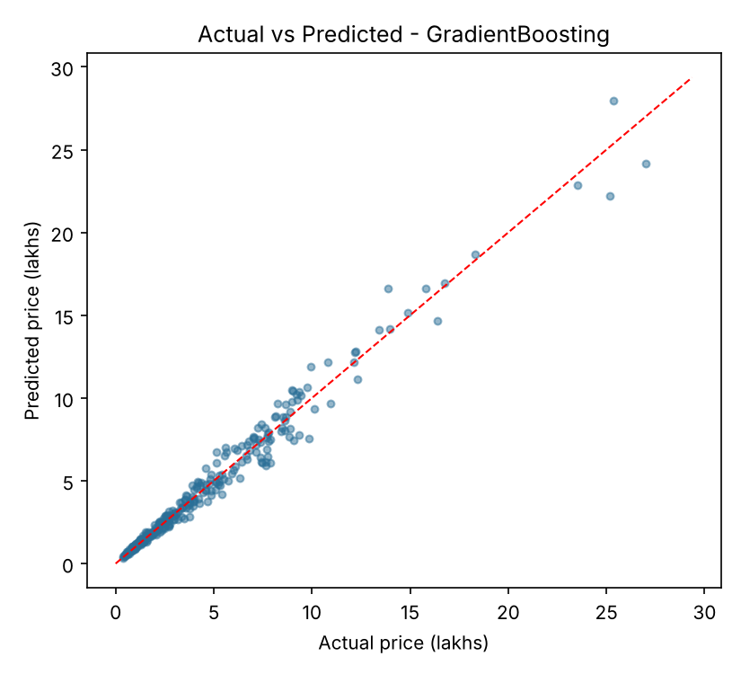
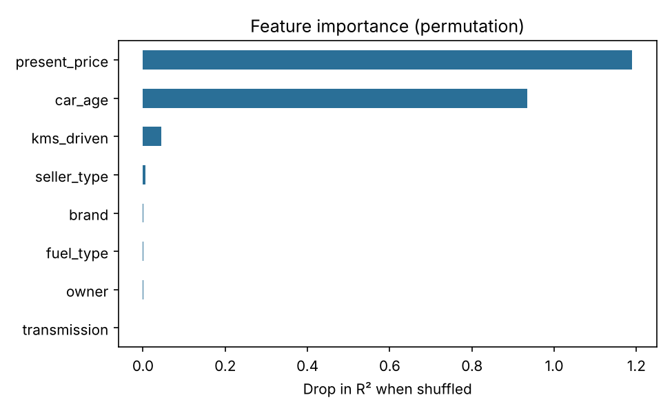

# 🚗 Used Car Price Predictor

[](https://github.com/<your-username>/used-car-price-predictor/actions)

An end-to-end machine learning project that estimates the **resale price of a used car** (in lakhs of ₹) from its brand, age, kilometres driven, fuel type, transmission, seller type, number of previous owners and showroom price.

It covers the full workflow: data cleaning, feature engineering, model comparison with hyper-parameter tuning, evaluation, model persistence, a command-line tool, a **Streamlit web app**, unit tests and CI.

## Highlights

- **Clean, modular code**: `data.py` (cleaning), `model.py` (pipelines), `train.py`, `predict.py`
- **Leak-free pipeline**: preprocessing lives inside a scikit-learn `Pipeline`, so scaling and encoding are fit only on training folds
- **Log-transformed target** (`TransformedTargetRegressor`) to handle skewed prices
- Compares **Ridge**, **Random Forest** and **Gradient Boosting** using `GridSearchCV` (5-fold). The best model is chosen by CV score, not the test set
- Handles both popular CarDekho CSV layouts (prices in lakhs or in rupees)
- Evaluation plots: actual vs predicted, residuals, permutation feature importance
- Streamlit app, CLI, `pytest` suite, GitHub Actions CI

## Results

Evaluated on a held-out 20% test set:

| Model             | CV MAE (lakhs) | Test R² | Test MAE (lakhs) | Test RMSE (lakhs) |
|-------------------|----------------|---------|------------------|-------------------|
| Gradient Boosting | 0.396          | 0.977   | 0.390            | 0.638             |
| Random Forest     | 0.452          | 0.966   | 0.463            | 0.775             |
| Ridge             | 0.670          | 0.929   | 0.645            | 1.119             |

> ⚠️ **Note on data:** these numbers come from the bundled *synthetic* sample dataset (`data/car_data.csv`, generated by `src/generate_sample_data.py`) so the project runs out of the box. Real-world data is noisier, so expect lower scores with the actual CarDekho dataset. Replace the CSV (see below) and re-run training to get genuine results, then update this table.




## Project Structure

```
used-car-price-predictor/
├── app.py                     # Streamlit web app
├── data/car_data.csv          # sample dataset (synthetic)
├── src/
│   ├── config.py              # paths, constants, feature lists
│   ├── data.py                # loading, cleaning, feature engineering
│   ├── model.py               # pipelines + hyper-parameter grids
│   ├── train.py               # training, tuning, evaluation, plots
│   ├── predict.py             # CLI + reusable predict function
│   └── generate_sample_data.py
├── tests/test_pipeline.py
├── reports/                   # metrics + figures
├── models/                    # saved model (git-ignored)
├── .github/workflows/ci.yml
└── requirements.txt
```

## Getting Started

```bash
git clone https://github.com/<your-username>/used-car-price-predictor.git
cd used-car-price-predictor

python -m venv .venv
source .venv/bin/activate          # Windows: .venv\Scripts\activate
pip install -r requirements.txt
```

### 1. Train

```bash
python -m src.train
# or with your own CSV
python -m src.train --data path/to/your.csv
```

### 2. Predict from the command line

```bash
python -m src.predict --brand Maruti --year 2018 --kms 45000 \
    --fuel Petrol --seller Individual --transmission Manual \
    --owner 0 --present-price 6.5
```

### 3. Launch the web app

```bash
pip install -r requirements-app.txt
streamlit run app.py
```

### 4. Run tests

```bash
pytest
```

## Using the real CarDekho dataset

1. Download from Kaggle either **"Vehicle dataset from CarDekho"** (`car data.csv`) or **"CAR DETAILS FROM CAR DEKHO"**.
2. Save it as `data/car_data.csv` (or pass `--data`).
3. Run `python -m src.train`.

Required columns (case-insensitive): car name, year, selling price, kms driven, fuel type, seller type, transmission, owner. A `present_price` column is used when available. For the smaller dataset, `brand` is the first word of the name (a model name like "swift"); for the larger one it is the manufacturer.

## How It Works

1. **Cleaning**: standardise column names, drop duplicates and impossible rows, convert rupees to lakhs if needed
2. **Features**: `car_age = reference_year - year`, `brand` = first word of the car name
3. **Preprocessing**: `StandardScaler` for numeric features, `OneHotEncoder` for categorical features
4. **Modelling**: `log1p(price)` target, 3 candidate models tuned with 5-fold grid search
5. **Selection & evaluation**: best CV MAE wins, then it is evaluated once on the test set
6. **Persistence**: the model plus feature list and metadata are saved with `joblib`

## Ideas for Extension

- Add the car's model/variant, location and body type as features
- Try XGBoost / LightGBM and Optuna for tuning
- Add prediction intervals (quantile regression)
- Deploy the Streamlit app on Streamlit Community Cloud or Hugging Face Spaces

## License

MIT, see [LICENSE](LICENSE).
